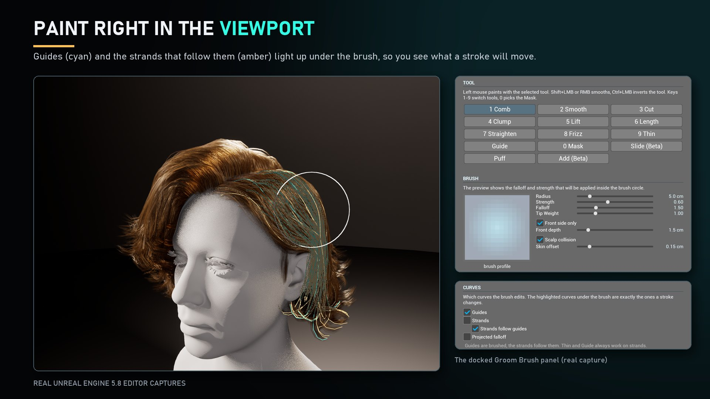
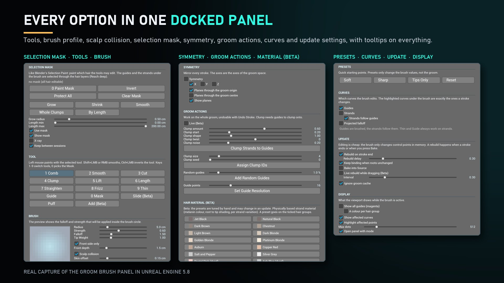
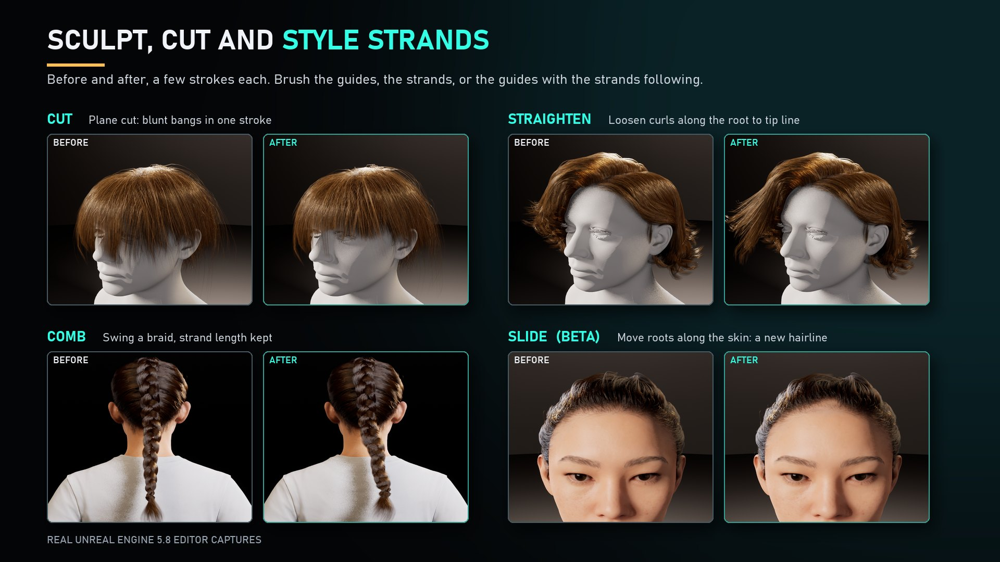
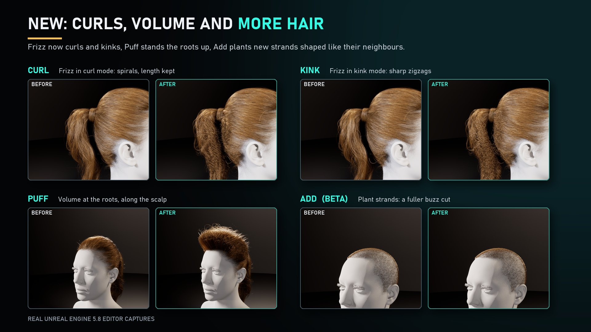
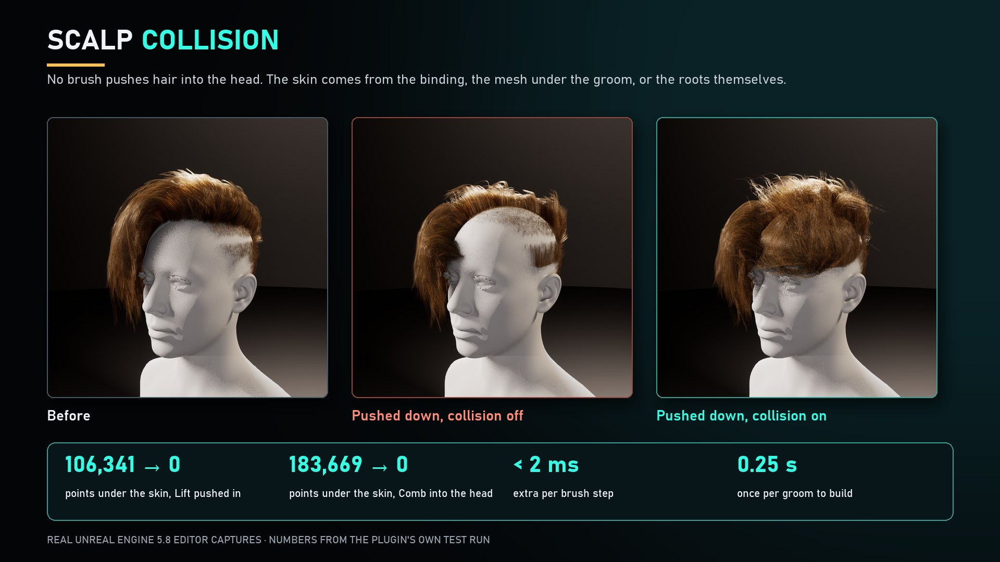
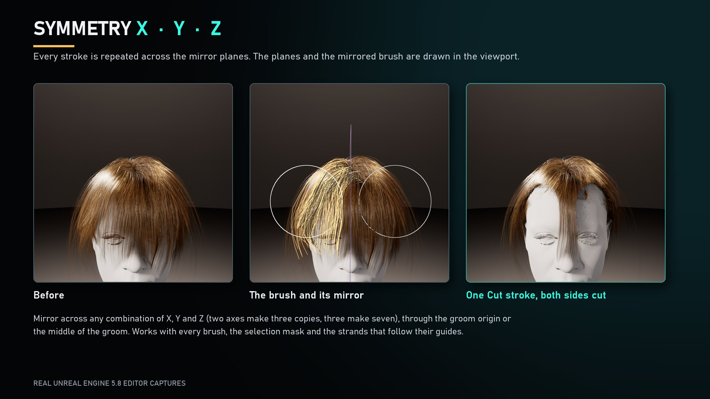
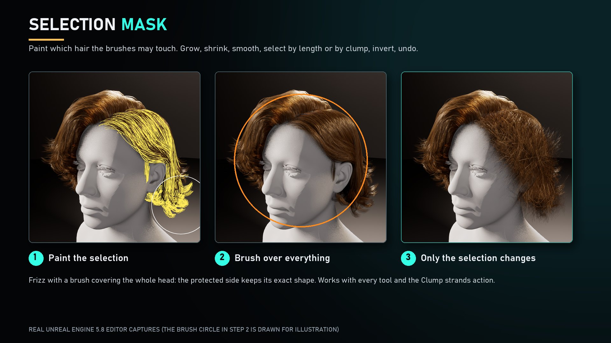
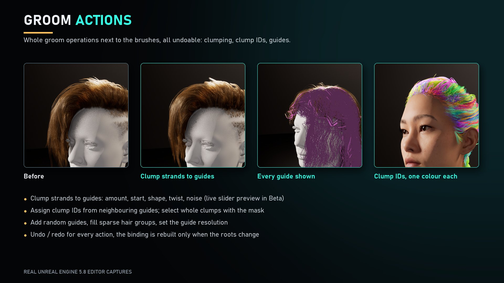
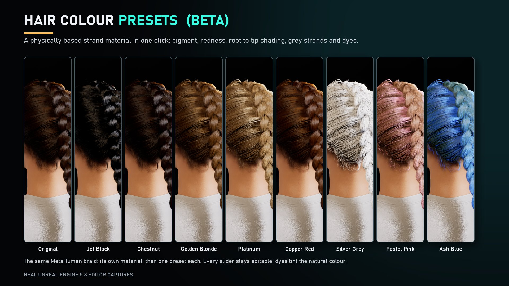
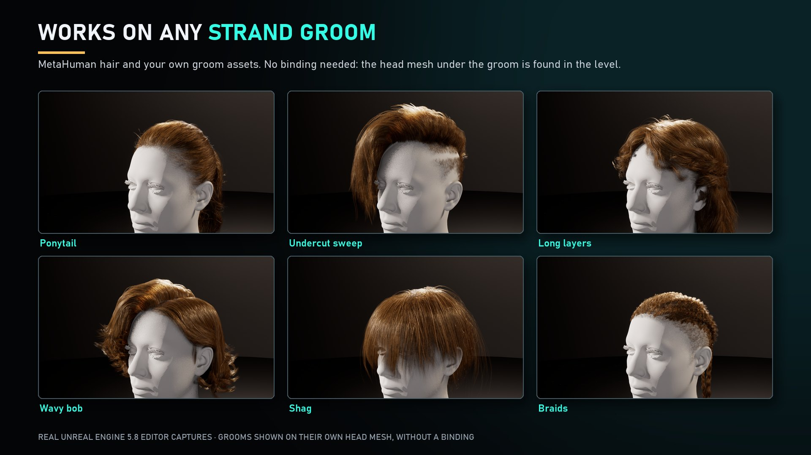

# Groom Brush — 사용 가이드 (v0.1.0)

[🇺🇸 English](./index.md) | 🇰🇷 한국어

Groom Brush는 **언리얼 엔진 레벨 에디터 뷰포트 안에서** 그룸(Groom) 에셋의 헤어 곡선을 브러시로 빗고, 매끄럽게 하고, 자르고, 뭉치고, 들어 올리고, 컬을 만들 수 있게 해 주는 플러그인입니다. Blender의 헤어 브러시와 비슷하게 동작합니다. 선택 마스크, 대칭, 그룸 전체 작업(클럼프, 클럼프 ID, 가이드), 물리 기반 헤어 머티리얼과 색상 프리셋도 제공합니다.

*언리얼 엔진 5.8 에디터 캡처입니다. 이 가이드의 그림은 플러그인을 실제로 캡처한 화면을 편집한 것이고, 그림 속 설명 글자는 나중에 추가했습니다.*

Groom Brush는 Fab에서 [Chamiseul Studio Ci](https://www.fab.com/sellers/Chamiseul%20Studio%20Ci)가 판매합니다. 이 가이드는 플러그인 안에도 `Docs/GroomBrush_Guide.md`로 들어 있습니다(영문).

## 1. 요구 사항

| | |
|---|---|
| 엔진 | 언리얼 엔진 **5.8** 전용 |
| 플랫폼 | Windows 64비트, 에디터 전용 (패키징된 게임에는 아무것도 추가되지 않습니다) |
| 필요한 플러그인 | **Groom** (플러그인 이름 `HairStrands`). Groom Brush를 켜면 자동으로 함께 켜집니다. |
| 콘텐츠 | 레벨의 Groom Component가 쓰는 Groom 에셋(스트랜드 방식 헤어). 예: MetaHuman 헤어나 직접 만든 그룸 |

그룸에 바인딩(Groom Binding)이 없어도 됩니다. 바인딩이 있으면 그 스킨 메시를 두피로 씁니다. 없으면 그룸이 붙어 있거나 겹쳐 있는 레벨의 스켈레탈 메시를 찾고, 그것도 없으면 헤어 뿌리가 만드는 표면을 두피로 사용합니다.

## 2. 설치

1. Epic Games 런처나 Fab에서 엔진에 플러그인을 설치하거나, `GroomBrush` 폴더를 프로젝트의 `Plugins` 폴더에 복사합니다.
2. 프로젝트를 엽니다. 언리얼이 모듈을 다시 빌드하겠냐고 물으면 **Yes**를 고릅니다.
3. **Edit > Plugins > Hair > Groom Brush**가 켜져 있는지 확인하고, 안내가 나오면 에디터를 다시 시작합니다.

## 3. 빠른 시작

1. 레벨에 Groom Component가 있는 액터(예: MetaHuman)를 두고 **선택**합니다.
2. 레벨 에디터 툴바의 **Groom Brush** 버튼을 누르거나 **Window > Groom Brush**를 엽니다. Groom Brush 패널이 열립니다.
3. **Activate Mode**를 누릅니다. 이제 뷰포트에서 선택한 도구로 헤어를 칠할 수 있습니다.
4. 도구를 고르고(키 **1-9**, 마스크는 **0**), Radius와 Strength를 정한 뒤 헤어 위를 드래그합니다. 브러시 아래의 곡선이 선으로 그려지므로 한 번의 스트로크가 무엇을 바꾸는지 정확히 볼 수 있습니다.
5. 같은 액터의 다른 그룸 컴포넌트(머리카락, 수염, 눈썹 등)는 **<**, **>** 버튼으로 바꿉니다.
6. 마음에 들면 **Bake to Asset**을 누르고, 콘텐츠 브라우저에서 Groom 에셋을 저장합니다.

!!! warning "백업하세요"
    Groom Brush는 복사본이 아니라 그룸 에셋 자체를 수정합니다. 시작하기 전에 그룸 에셋을 복제하거나 프로젝트를 버전 관리 하에 두세요. **Undo Stroke**는 모드가 켜져 있는 동안 마지막 스트로크 이전의 곡선으로 되돌립니다.

## 4. 마우스와 키보드

| 입력 | 동작 |
|---|---|
| 마우스 왼쪽 버튼 | 선택한 도구로 칠하기 |
| Shift + 왼쪽 버튼, 또는 오른쪽 버튼 | (어떤 도구에서든) 매끄럽게 |
| Ctrl + 왼쪽 버튼 | 도구 반전 (펼치기, 밀기, 줄이기, 가이드 제거, 마스크 지우기 등) |
| **1 ... 9**, **0** | Comb, Smooth, Cut, Clump, Lift, Length, Straighten, Frizz, Thin, Mask |
| **[** 와 **]** | 브러시 작게 / 크게 |
| Ctrl + Z, Ctrl + Shift + Z 또는 Ctrl + Y | 스트로크 실행 취소, 다시 실행 |
| 스트로크 중 Esc | 스트로크 취소 |
| 마우스 가운데 버튼 | 평소처럼 뷰포트 이동 |

## 5. 도구

| 도구 | 하는 일 |
|---|---|
| **Comb** | 커서를 따라 헤어를 끕니다. 뿌리는 고정됩니다. *Keep segment length*를 켜면 늘어나지 않고 이동한 점을 따라 흔들립니다. |
| **Smooth** | 곡선을 이웃 곡선의 평균 쪽으로 풀어 줍니다. |
| **Cut** | 가위입니다. 브러시에 들어온 지점에서(구형) 또는 한 줄을 따라(평면: 화면 가로 또는 월드 높이) 닿은 모든 스트랜드를 자릅니다. 옵션: 뿌리 유지, 지터, 최소 길이, 포인트 수 유지, 부드러운 가장자리. |
| **Clump** | 헤어를 뭉칩니다. 모드: 브러시 축으로, 가장 가까운 가이드로, 각 클럼프의 중앙으로 끌어당기기. 옵션: 시작, 모양, 꼬임, 노이즈. Ctrl은 퍼뜨립니다. |
| **Lift** | 헤어를 카메라 쪽이나 위로 끌어 올립니다. Ctrl은 되밉니다. |
| **Length** | 닿은 곡선을 길게 합니다. Ctrl은 줄입니다. |
| **Straighten** | 길이를 유지한 채 곡선을 뿌리에서 끝 방향으로 펴 줍니다. |
| **Frizz** | 웨이브, 컬, 꺾임을 만듭니다. 컬 크기와 빈도를 조절할 수 있습니다. 브러시를 오래 누를수록 패턴이 강해집니다. |
| **Thin** | 브러시 아래 스트랜드를 삭제합니다. 가이드는 삭제되지 않습니다. |
| **Guide** | 브러시 아래 스트랜드를 가이드로 승격합니다. Ctrl은 가이드를 제거합니다(하나는 항상 남습니다). |
| **Puff** | 두피 법선 방향으로 뿌리를 세워 볼륨을 줍니다. Ctrl은 평평하게 눕힙니다. |
| **Slide (Beta)** | 뿌리까지 포함해 헤어 전체를 두피 위에서 옮깁니다. 바인딩된 MetaHuman 그룸에서 테스트했습니다. |
| **Add (Beta)** | 브러시 아래 두피에 주변 헤어와 같은 모양의 새 스트랜드를 심습니다. Ctrl은 솎아 냅니다. 스트랜드에만 작용합니다. |
| **Mask** | 다른 도구가 수정할 수 있는 헤어를 칠해서 정합니다(8장 참고). |

각 도구의 옵션은 패널의 **TOOL OPTIONS** 영역에 나타납니다.

## 6. 브러시 설정

* **Radius**(cm), **Strength**, **Falloff**, **Tip Weight**가 브러시를 정합니다. 패널에 Falloff 미리보기가 그려집니다.
* **Presets**: Soft, Sharp, Tips Only, Reset은 브러시 값만 바꾸고 그룸은 바꾸지 않습니다.
* **Front side only**와 **Front depth**는 스트로크를 그룸의 보이는 쪽에만 적용해서 가려진 뒤쪽은 건드리지 않습니다.
* **Projected falloff**는 화면의 브러시 원 아래 전부에 닿습니다. 실루엣 작업에 좋습니다.
* **Scalp collision**과 **Skin offset**: 어떤 브러시도 헤어를 머리 속으로 밀어 넣지 않습니다. 피부 아래로 들어갈 점은 설정한 오프셋만큼 피부 위로 되돌려 놓습니다. 이미 피부 아래에 있던 헤어는 그대로 둡니다.

### 곡선: 가이드와 스트랜드

* **Guides**는 가이드 곡선(시안)을, **Strands**는 렌더링되는 스트랜드 곡선(주황)을 수정합니다. 둘 다 체크하면 둘 다 수정합니다.
* **Strands follow guides**: 가이드만 수정할 때 각 스트랜드가 가장 가까운 가이드 3개를 따라갑니다. Blender의 가이드 보간과 같습니다.
* **Hair groups**: 수정할 헤어 그룹을 고릅니다(All, Only, 개별 체크). **Fill Sparse**는 가이드가 부족한 그룹에 가이드를 채웁니다.

### 업데이트

* *Rebuild on stroke end*는 마우스를 놓을 때 스트로크를 확정합니다. *Rebuild delay*는 빠른 스트로크를 묶어 한 번에 재빌드합니다. *Keep binding when roots unchanged*는 바인딩 재빌드를 건너뛰어 MetaHuman 그룸에서 헤어가 깜빡이는 것을 막습니다. *Live rebuild while dragging (Beta)*는 드래그 중에도 갱신하지만 간격마다 전체 재빌드 비용이 듭니다.
* **Rebuild Groom**은 현재 곡선으로 파생 데이터와 바인딩을 다시 만듭니다.
* **Bake to Asset**은 수정한 곡선을 그룸 에셋과 Source description에 써 넣어서 저장하고 다시 열어도 유지되게 합니다.

## 7. 대칭

**Symmetry**를 켜고 **X**, **Y**, **Z** 중 원하는 축을 체크합니다. 모든 스트로크가 켜진 평면을 기준으로 대칭 복제되어 가이드와 스트랜드에 함께 적용됩니다. 축 2개면 복사본 3개, 3개면 7개가 됩니다. 평면은 그룸 원점(MetaHuman 그룸에서는 머리 중앙)이나 그룸 경계의 중심을 지나게 할 수 있습니다. *Show planes*는 평면과 대칭 브러시를 뷰포트에 그립니다.

## 8. 선택 마스크

마스크는 Blender의 Selection Paint처럼 다른 도구가 수정할 수 있는 헤어를 제한합니다.

* **Mask** 도구(0번 키)를 골라 칠합니다. Ctrl + 칠하기는 헤어를 보호합니다.
* **Invert**, **Protect All**, **Clear Mask**, **Grow**, **Shrink**, **Smooth**, **Whole Clumps**, **By Length**로 선택 영역을 다듬습니다.
* **Use mask**는 제한을 켜고 끄고, **Show mask**와 **X-ray**는 선택 영역을 그리며, **Keep between sessions**는 마스크를 프로젝트의 `Saved/GroomBrush/Masks`에 저장합니다. 마스크는 그룸 에셋에 기록되지 않습니다.

## 9. 그룸 액션

액션은 그룸 전체에 작용하며 **Undo Stroke**로 되돌릴 수 있습니다.

* **Clump Strands to Guides**: 모든 스트랜드를 가장 가까운 가이드로 끌어당깁니다. 슬라이더: Clump amount, start, shape, twist, noise. **Live (Beta)**를 켜면 슬라이더를 따라 그룸이 바뀌고 버튼은 결과를 확정합니다. 그룸에 가이드가 있어야 하니 먼저 Guide 도구나 *Add Random Guides*를 쓰세요.
* **Assign Clump IDs**: 모든 스트랜드가 가장 가까운 가이드의 클럼프 ID를 받습니다(Clump size, Clump seed). 언리얼이 셰이딩과 시뮬레이션에 클럼프 ID를 씁니다.
* **Add Random Guides**(스트랜드 비율)와 **Set Guide Resolution**(가이드당 컨트롤 포인트 수).
* **Show all guides**는 체크된 헤어 그룹의 모든 가이드를 그립니다. 언리얼은 가이드를 렌더링하지 않으므로 이것이 가이드를 보는 유일한 방법입니다.

## 10. 헤어 머티리얼 (Beta)

**HAIR MATERIAL**에서 프리셋을 고르면 체크된 헤어 그룹에 물리 기반 스트랜드 머티리얼 인스턴스가 만들어집니다. 프리셋에는 Jet Black, Chestnut, Golden Blonde, Platinum, Copper Red, Silver Grey, Pastel Pink, Ash Blue 등이 있습니다.

* 머티리얼 인스턴스는 프로젝트의 `/Game/GroomBrush/Materials/Instances`에 `MI_<그룸이름>_GroomBrushHair`로 저장됩니다.
* 슬라이더: 멜라닌, 붉은기, 거칠기, 흰 머리, 뿌리와 끝 음영, 하이라이트, 클럼프별 변화, 염색 강도와 옴브레, 스페큘러, 백릿, 앰비언트 오클루전.
* **Write into the groom asset**을 켜면 에셋의 머티리얼 슬롯에 머티리얼을 설정합니다. 끄면 선택한 컴포넌트만 덮어씁니다.
* **Open Material**은 모든 파라미터가 있는 인스턴스를 엽니다. **Restore Original**은 이 컴포넌트의 덮어쓰기를 제거합니다.
* 프리셋은 손으로 조정한 것이며 업데이트에서 바뀔 수 있습니다.

## 11. 어떤 스트랜드 그룸에서도 동작

## 12. 블루프린트와 파이썬

에디터 전용 함수 라이브러리 `GroomBrush`(카테고리 *GroomBrush*)를 에디터 유틸리티 블루프린트와 파이썬에서 호출할 수 있습니다: `ApplyBrushToGroom`, `CombGroom`, `SmoothGroom`, `ClumpGroomToGuides`, `AssignGroomClumpIDs`, `AddGroomRandomGuides`, `FillGroomSparseGuides`, `ResampleGroomGuides`, `GetGroomStats`. 브러시 기본값은 프로젝트의 에디터 설정에 저장되며 Groom Brush 설정에서 바꿀 수 있습니다.

## 13. 팁과 문제 해결

* **"Select an actor that has a groom component with a groom asset"**: 레벨에서 액터를 먼저 선택한 뒤 Activate Mode를 누르세요.
* **브러시 아래에서 아무것도 안 바뀝니다**: CURVES에서 *Guides*나 *Strands*가 체크돼 있는지, 헤어 그룹이 체크돼 있는지, *Use mask*가 그 영역을 막고 있지 않은지 확인하세요. Groom Cache가 지정돼 있으면 *Ignore groom cache*를 체크하세요.
* **헤어가 큰 덩어리로 움직입니다**: 그룸에 가이드가 적습니다. *Fill Sparse*나 *Add Random Guides*를 쓰거나 *Strands*를 직접 수정하세요.
* **Clump가 아무 효과가 없습니다**: 뭉칠 대상인 가이드가 그룸에 있어야 합니다.
* **Slide와 Add는 Beta입니다**: Slide는 바인딩된 MetaHuman 그룸에서 테스트했습니다. 결과를 확인하고 마음에 들지 않으면 Undo Stroke를 쓰세요.
* **성능**: 브러시 반경을 줄이고, *Live rebuild while dragging*을 끄고, *Keep binding when roots unchanged*는 켜 두세요.
* **다른 엔진 버전**: Groom Brush는 현재 언리얼 엔진 5.8만 지원합니다.

## 14. 라이선스

Groom Brush는 상용 소프트웨어입니다. 라이선스 조건은 플러그인 폴더의 `LICENSE.txt`를 참고하세요.

Copyright 2026 Chamiseul Studio Ci. All Rights Reserved.
