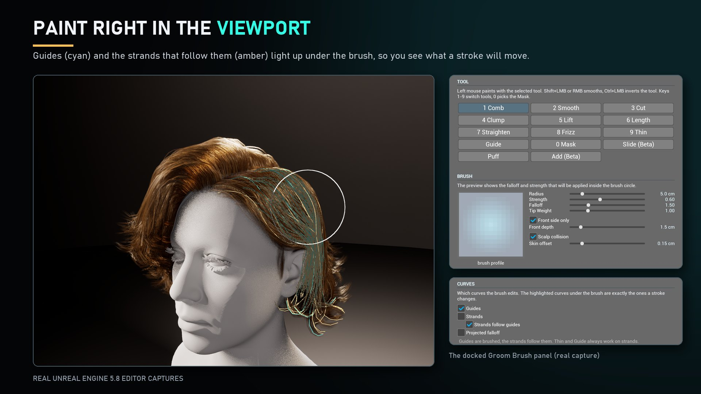
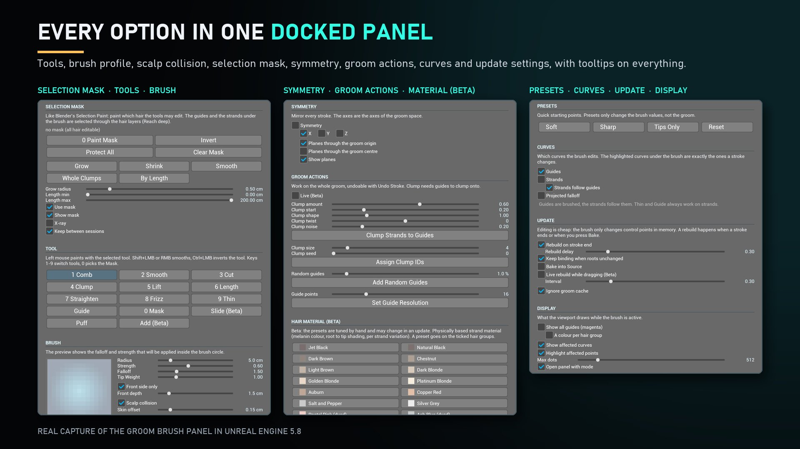
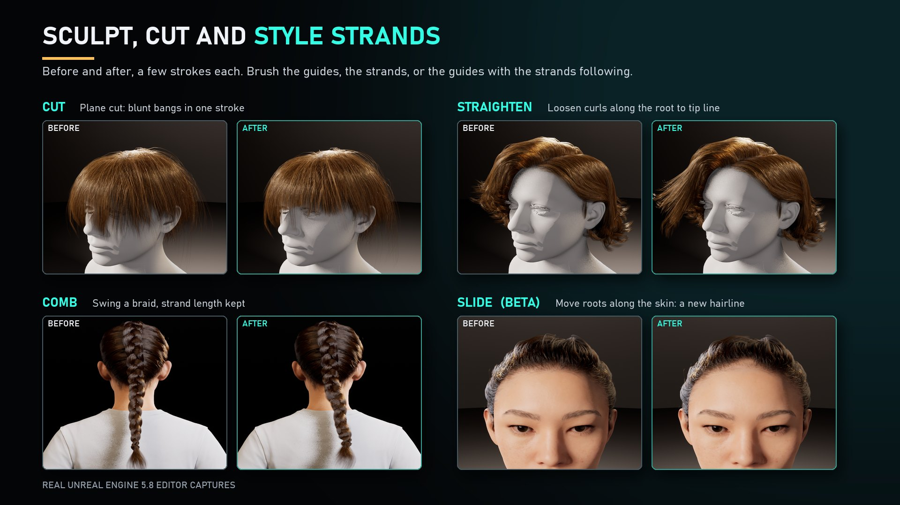
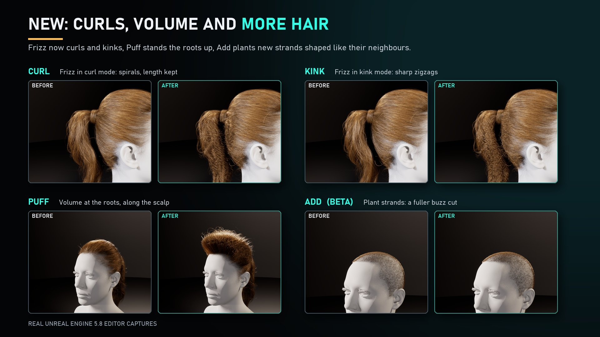
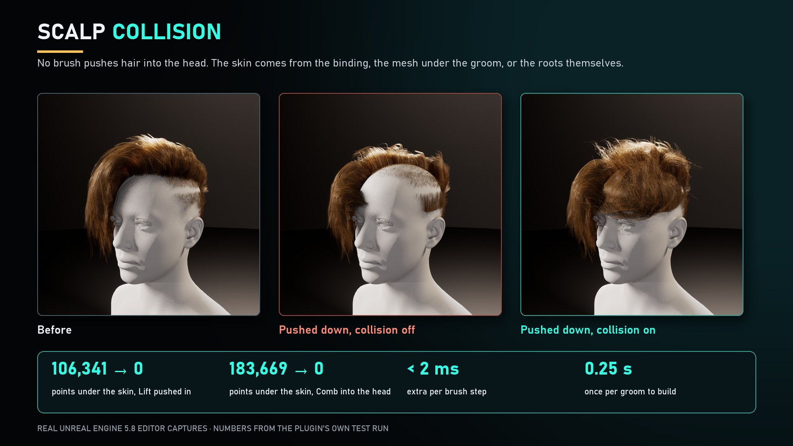
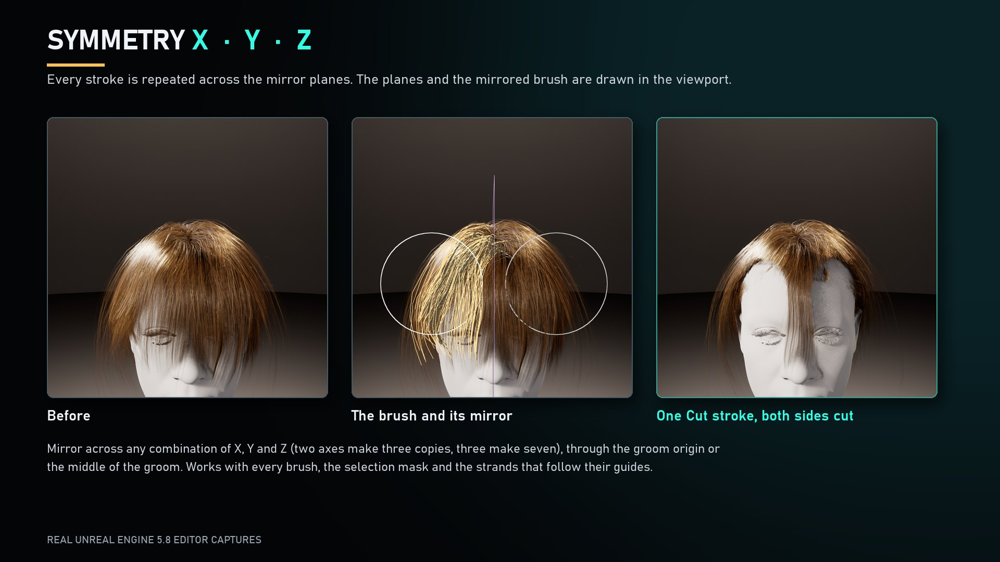
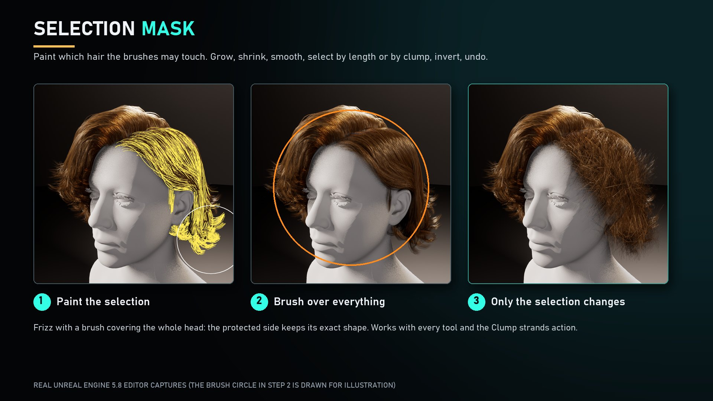
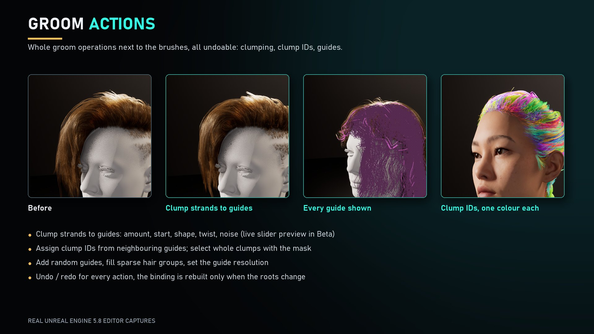
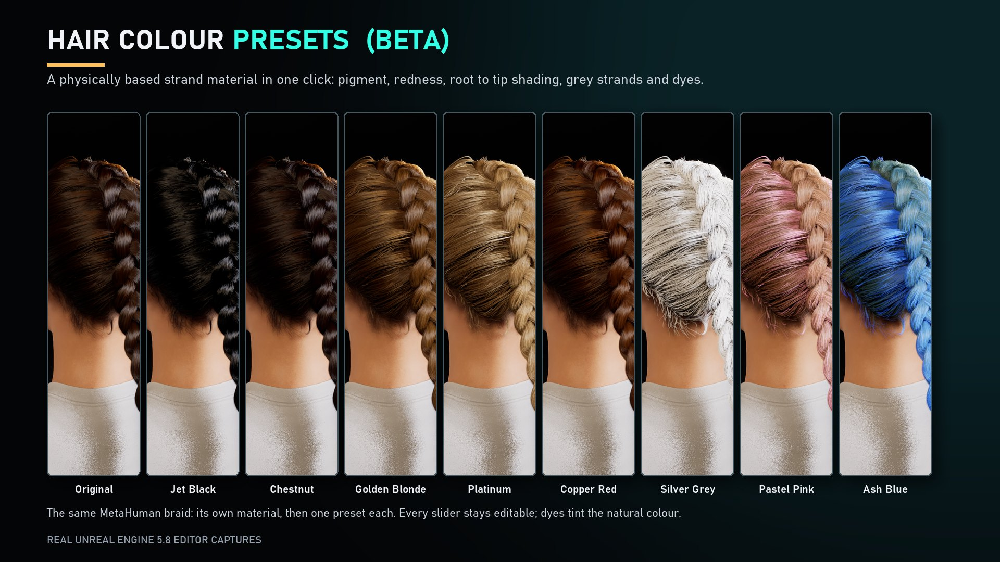
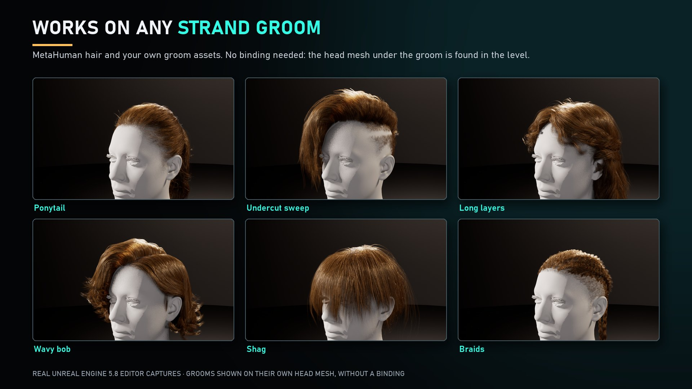

# Groom Brush — User Guide (v0.1.0)

🇺🇸 English | [🇰🇷 한국어](./KO_index.md)

Groom Brush lets you comb, smooth, cut, clump, lift, curl and otherwise reshape the hair curves of a Groom asset **directly in the Unreal Engine level editor viewport**, with brushes, the way the hair brushes work in Blender. It also gives you a selection mask, symmetry, groom-wide actions (clumping, clump IDs, guides) and a physically based hair material with colour presets.

*Unreal Engine 5.8 editor captures. The pictures in this guide are composed from real captures of the plugin; the captions in the pictures were added afterwards.*

Groom Brush is sold on Fab by [Chamiseul Studio Ci](https://www.fab.com/sellers/Chamiseul%20Studio%20Ci). This guide is also included in the plugin as `Docs/GroomBrush_Guide.md`.

## 1. Requirements

| | |
|---|---|
| Engine | Unreal Engine 5.8 only |
| Platform | Windows 64-bit, editor only (nothing is added to packaged games) |
| Required plugin | **Groom** (plugin name `HairStrands`). It is enabled automatically together with Groom Brush. |
| Content | A Groom Asset (strand based hair) used by a Groom Component in your level, for example MetaHuman hair or your own grooms. |

A groom does not need a binding. If the groom has a Groom Binding, Groom Brush uses the binding's skin mesh as the scalp. Otherwise it looks for the skeletal mesh the groom hangs on or overlaps in the level, and as a last resort it uses the surface the hair roots make.

## 2. Install

1. Install the plugin to your engine from the Epic Games launcher / Fab, or copy the `GroomBrush` folder into the `Plugins` folder of your project.
2. Open the project. If Unreal asks to rebuild the module, choose **Yes**.
3. Check that **Edit > Plugins > Hair > Groom Brush** is enabled and restart the editor if asked.

## 3. Quick start

1. Place an actor with a Groom Component in the level (for example a MetaHuman) and **select it**.
2. Click the **Groom Brush** button in the level editor toolbar, or open **Window > Groom Brush**. The Groom Brush panel opens.
3. Press **Activate Mode**. The viewport now paints hair with the selected tool.
4. Pick a tool (keys **1-9**, **0** for the mask), set Radius and Strength, and drag over the hair. The curves under the brush are drawn as lines, so you see exactly what a stroke changes.
5. Work on a different groom component of the same actor (hair, beard, eyebrows ...) with the **<** and **>** buttons.
6. When you are happy press **Bake to Asset**, then save the Groom Asset in the Content Browser.

!!! warning "Make a backup"
    Groom Brush edits the groom asset itself, not a copy. Duplicate the groom asset (or keep your project under version control) before you start. **Undo Stroke** restores the curves from before the last stroke while the mode is active.

## 4. Mouse and keyboard

| Input | Action |
|---|---|
| Left mouse button | Paint with the selected tool |
| Shift + left mouse button, or right mouse button | Smooth (with any tool) |
| Ctrl + left mouse button | Invert the tool (spread, push, shrink, remove guides, erase mask ...) |
| **1 ... 9**, **0** | Comb, Smooth, Cut, Clump, Lift, Length, Straighten, Frizz, Thin, Mask |
| **[** and **]** | Smaller / bigger brush |
| Ctrl + Z, Ctrl + Shift + Z or Ctrl + Y | Undo stroke, redo stroke |
| Esc while stroking | Cancel the stroke |
| Middle mouse button | Viewport navigation as usual |

## 5. Tools

| Tool | What it does |
|---|---|
| **Comb** | Drags the hair along the cursor. Roots stay pinned. *Keep segment length* lets the hair swing after the moved point instead of stretching. |
| **Smooth** | Relaxes curves towards the average of their neighbours. |
| **Cut** | Scissors. Cuts every touched strand where it enters the brush (sphere) or along one line (plane, horizontal on screen or at a world height). Options: keep root, jitter, keep at least, keep point count, soft edge. |
| **Clump** | Pinches hair together. Modes: pull to the brush axis, to the nearest guide, or to the middle of each clump. Options: start, shape, twist, noise. Ctrl spreads. |
| **Lift** | Pulls hair towards the camera or straight up. Ctrl pushes it back. |
| **Length** | Grows the touched curves. Ctrl shrinks them. |
| **Straighten** | Straightens curves along root to tip, keeping their length. |
| **Frizz** | Waves, curls or kinks. Curl size and frequency are adjustable. Hold the brush longer for a stronger pattern. |
| **Thin** | Deletes strands under the brush. Guides are never deleted. |
| **Guide** | Promotes the strands under the brush to guides. Ctrl removes guides (one always stays). |
| **Puff** | Stands the hair up at the roots along the scalp normal for volume. Ctrl lays it down flat. |
| **Slide (Beta)** | Moves whole hairs over the scalp, roots included. Tested on bound MetaHuman grooms. |
| **Add (Beta)** | Plants new strands on the scalp under the brush, shaped like the hair around them. Ctrl thins. Works on strands. |
| **Mask** | Paints which hair the other tools may edit (see section 8). |

Each tool shows its own options in the **TOOL OPTIONS** section of the panel.

## 6. Brush settings

* **Radius** (cm), **Strength**, **Falloff** and **Tip Weight** shape the brush. A preview of the falloff is drawn in the panel.
* **Presets**: Soft, Sharp, Tips Only and Reset change only the brush values, never the groom.
* **Front side only** and **Front depth** keep a stroke on the visible side of the groom so the hidden back is untouched.
* **Projected falloff** reaches everything under the brush circle on screen, good for silhouettes.
* **Scalp collision** and **Skin offset**: no brush pushes hair into the head. Points that would go under the skin are put back on it, to the offset you set. Hair that already is under the skin stays where it is.

### Curves: guides and strands

* **Guides** edits the guide curves (cyan). **Strands** edits the rendered strand curves (orange). Tick both to edit both.
* **Strands follow guides**: when only guides are edited, each strand follows its three nearest guides, like guide interpolation in Blender.
* **Hair groups**: choose which hair groups of the groom are edited (All, Only, or tick individual groups). **Fill Sparse** adds guides to groups that have too few.

### Update

* *Rebuild on stroke end* commits a stroke when you release the mouse. *Rebuild delay* batches quick strokes. *Keep binding when roots unchanged* skips the binding rebuild and avoids hair flicker on MetaHuman grooms. *Live rebuild while dragging (Beta)* updates during the drag at the cost of a full rebuild per interval.
* **Rebuild Groom** rebuilds the derived data and the binding from the current curves.
* **Bake to Asset** writes the edited curves into the groom asset and its Source description, so they survive saving and reloading.

## 7. Symmetry

Turn on **Symmetry** and tick **X**, **Y** and/or **Z**. Every stroke is repeated mirrored across the enabled planes, on guides and strands. Two axes make three copies, three axes make seven. The planes can pass through the groom origin (the middle of the head for a MetaHuman groom) or through the centre of the groom's bounds. *Show planes* draws the planes and the mirrored brushes in the viewport.

## 8. Selection mask

The mask works like Selection Paint in Blender: it limits which hair the other tools may change.

* Select the **Mask** tool (key 0) and paint. Ctrl + paint protects hair.
* **Invert**, **Protect All**, **Clear Mask**, **Grow**, **Shrink**, **Smooth**, **Whole Clumps** and **By Length** edit the selection.
* **Use mask** switches the limit on and off, **Show mask** and **X-ray** draw the selection, **Keep between sessions** stores the mask under `Saved/GroomBrush/Masks` of your project. The mask is never written into the groom asset.

## 9. Groom actions

Actions work on the whole groom and can be undone with **Undo Stroke**.

* **Clump Strands to Guides**: pulls every strand onto its nearest guide. Sliders: Clump amount, start, shape, twist, noise. With **Live (Beta)** on, the groom follows the sliders and the button accepts the result. The groom needs guides; use the Guide tool or *Add Random Guides* first.
* **Assign Clump IDs**: every strand gets the clump ID of its nearest guide (Clump size, Clump seed). Unreal uses clump IDs for shading and simulation.
* **Add Random Guides** (percentage of strands) and **Set Guide Resolution** (control points per guide).
* **Show all guides** draws every guide of the ticked hair groups. Unreal never renders guides, so this is the only way to see them.

## 10. Hair material (Beta)

Pick a preset in **HAIR MATERIAL** to create a physically based strand material instance for the ticked hair groups. Presets include Jet Black, Chestnut, Golden Blonde, Platinum, Copper Red, Silver Grey, Pastel Pink and Ash Blue.

* The material instance is saved as `MI_<groom>_GroomBrushHair` in `/Game/GroomBrush/Materials/Instances`.
* Sliders: melanin, redness, roughness, grey strands, root and tip shading, highlights, per-clump variation, dye strength and ombre, specular, backlit and ambient occlusion.
* **Write into the groom asset** sets the material in the asset's material slots. Off: only the selected component is overridden.
* **Open Material** opens the instance with every parameter. **Restore Original** removes this component's overrides.
* The presets are tuned by hand and may change in an update.

## 11. Works on any strand groom

## 12. Blueprint and Python

The editor-only function library `GroomBrush` (category *GroomBrush*) can be called from Editor Utility Blueprints and Python: `ApplyBrushToGroom`, `CombGroom`, `SmoothGroom`, `ClumpGroomToGuides`, `AssignGroomClumpIDs`, `AddGroomRandomGuides`, `FillGroomSparseGuides`, `ResampleGroomGuides` and `GetGroomStats`. Brush defaults are stored in the project's editor config and can be changed in the Groom Brush settings.

## 13. Tips and troubleshooting

* **"Select an actor that has a groom component with a groom asset"**: select the actor in the level first, then press Activate Mode.
* **Nothing changes under the brush**: check that *Guides* or *Strands* is ticked under CURVES, that the hair group is ticked, and that *Use mask* is not hiding the area. If a Groom Cache is assigned, tick *Ignore groom cache*.
* **The hair moves in big pieces**: the groom has few guides. Use *Fill Sparse* or *Add Random Guides*, or edit *Strands* directly.
* **Clump has no effect**: the groom needs guides to clump onto.
* **Slide and Add are Beta**: Slide is tested on bound MetaHuman grooms. Check the result and use Undo Stroke if it is not what you want.
* **Performance**: lower the brush radius, turn off *Live rebuild while dragging* and leave *Keep binding when roots unchanged* on.
* **Other engine versions**: Groom Brush currently supports Unreal Engine 5.8 only.

## 14. License

Groom Brush is commercial software. See `LICENSE.txt` in the plugin folder for the license terms.

Copyright 2026 Chamiseul Studio Ci. All Rights Reserved.
